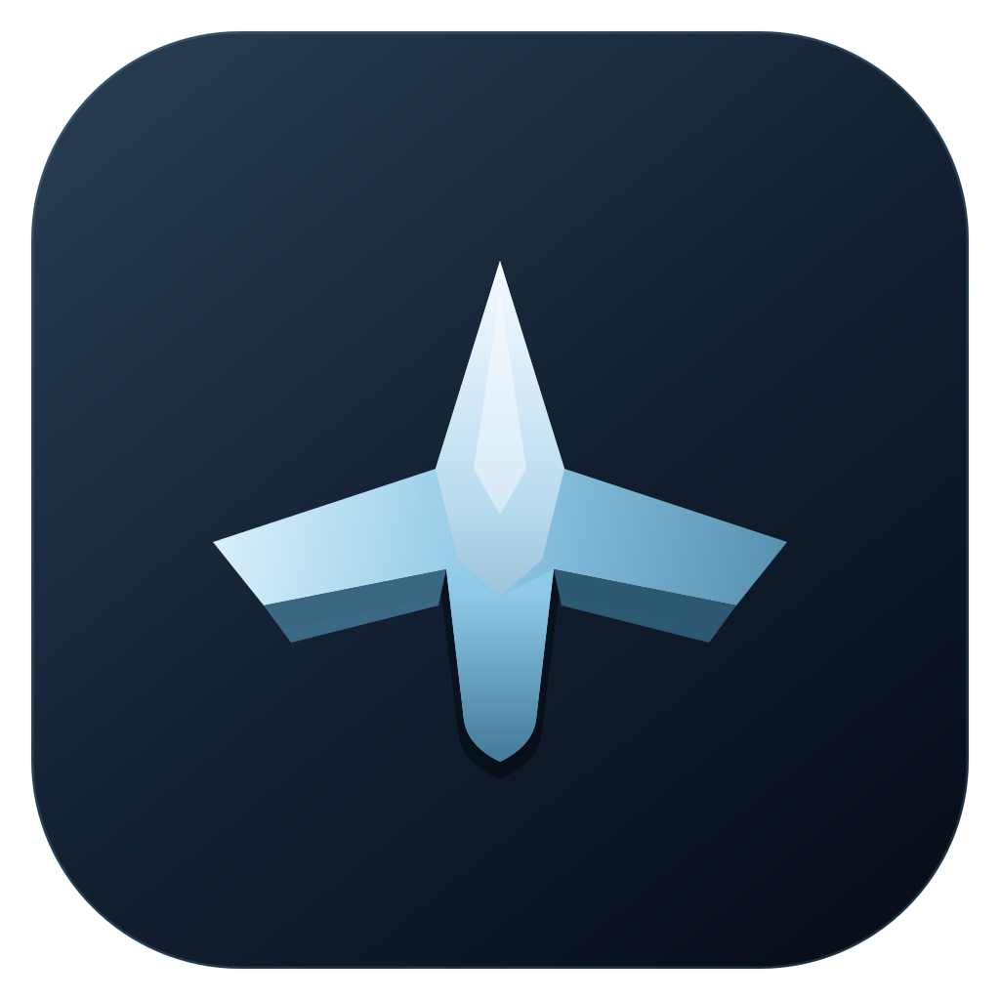
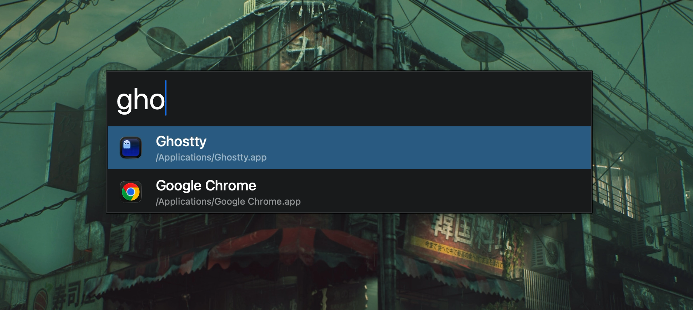

<p align="center">
  
</p>

# Cockpit

Cockpit is a local macOS launcher for opening applications and deliberately indexed filenames without Spotlight.



## Build and install

Cockpit requires macOS 13 or later and Xcode 15 or later. Build and run a development copy with:

```sh
swift test
swift run Cockpit
```

To build a release executable and install it as an Apple Development–signed local app in `~/Applications`:

```sh
Scripts/install-local.sh
```

Pass another writable app-bundle path to install elsewhere, for example:

```sh
Scripts/install-local.sh /tmp/Cockpit.app
```

> `Scripts/install-local.sh` requires an Apple Development signing identity,
> which Xcode can create from a free Apple ID. Notarization is not required for
> the local build.

Press **Option-Space** to show the Launcher by default. Use Cockpit’s menu-bar icon to choose **Settings…**, configure Launch at Login or select **Ctrl+Space**, **Alt+Space**, or **Cmd+Space**, or to show or quit the app. Cockpit searches `/Applications`, `/System/Applications`, `~/Applications`, the user-facing utilities in `/System/Library/CoreServices/Applications`, and the system Cryptex application location (including Safari) without Spotlight, alongside Lock, Restart, and Shut Down System actions. It also discovers tools in application bundles’ `Contents/Applications` and `Contents/Developer/Applications` directories, without exposing arbitrary bundle helpers. Overlapping locations and symlinks to the same application produce one result, using its native macOS icon. Select a result and press Return to open the application or run the System action.

## Clipboard history

Enable **Clipboard History** in Settings, then search for **Clipboard History** in the Launcher and press Return. It opens recent copies in the same single-column layout. Type to filter text and file paths; use the arrow keys to select an entry.

- **Return** (or double-click) copies and dismisses; press **⌘V** in your destination to paste.
- **⌘Return** copies as plain text: the original text, or newline-separated file paths. Images have no plain-text action.
- **Escape** dismisses. The next invocation returns to ordinary application-and-system search.

History is off by default and stays entirely on this Mac. It keeps at most **20 entries**, **25 MiB total**, and **5 MiB per entry**; the oldest copies roll off automatically. Oversized/unsupported copies are skipped. Text is stored as plain text, images as PNG, and files as references—not copies of their contents. A batch of up to 100 files occupies one entry. Image capture accepts PNG/TIFF data within the entry limit, up to 16 megapixels and 8192 pixels per edge; no OCR or file-content indexing runs.

Selecting an old entry does not duplicate it or change its position. Copying the same content again from another app moves its existing entry to newest. Capture checks for changes every half-second, so very rapid intermediate copies may be missed.

Disabling capture preserves existing history but records nothing while off. **Clear History…** in Settings removes saved entries, including while disabled; it leaves the current system clipboard and referenced files untouched. Known sensitive/concealed/transient clipboard markers are always respected, but unmarked secrets cannot be identified reliably. Storage under `~/Library/Application Support/Cockpit/ClipboardHistory/` is user-private, not encrypted by Cockpit, and may be included in system backups. Clear History is not forensic secure erasure. No new macOS permissions are requested.

## Performance acceptance benchmarks

On an Apple-silicon Mac, run the repeatable 50,000-item fixture benchmark with:

```sh
COCKPIT_RUN_BENCHMARKS=1 swift test --filter PerformanceBenchmarks
```

It verifies the documented p95 hotkey and p95/p99 ranked-query targets, plus clipboard search/selection targets with 20 short text entries (not a worst-case 25 MiB corpus). Filesystem freshness is covered by the filename-index change-event integration checks.

## Direct release

`Scripts/release.sh <version>` builds a hardened-runtime Developer ID app, submits it for notarization, staples the result, and emits a distributable zip. It requires `DEVELOPER_ID_APPLICATION` and `NOTARY_PROFILE`; the release bundle contains no entitlements or privileged helpers.
